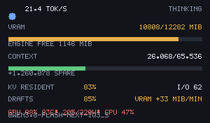

# llm-inference-monitor

A zero-dependency monitor for a local LLM inference stack. It reads the metrics your engine already
publishes, adds the derived numbers it does not (cache hit rate, speculation acceptance rate, VRAM
per context token, re-prefill cost), and puts them in a terminal dashboard or a desktop overlay so
you can watch speed, context economics and VRAM headroom at a glance.

Stdlib only: Python 3.10+, no pip installs, no telemetry, nothing leaves your machine.

```text
==============================================================================
Qwen3.8-Flash-next-DFlash2-GGUF   engine b8460-df7d0528b   ctx 65,536   [IDLE]
==============================================================================
  decode now         19.1 tok/s   .-==+*##%*+-::...

  CONTEXT ECONOMICS (since engine boot)
    cache hit        60.1% of prompt tokens reused   (1,290,496 / 2,147,328)
    fresh prefill       856,832 tokens
    I/O ratio              11.1 in-tokens per out-token
    prefill tax      68.7% of busy time   (4,096 tok/s prefill vs 20.6 tok/s decode)
    cost /1k out            50.8 s total   (34.9 s prefill + 15.9 s decode)

  SPECULATIVE DECODING (eagle3, depth 4)
    acceptance       86.5%   (12,970 of 14,994 drafts accepted)
    tokens / draft          1.87  mean bonus 0.87
    verdict         excellent: drafting is pulling its weight

  VRAM AND CONTEXT BUDGET
    driver VRAM     11575 MiB / 12879 MiB   (89.9%)   engine free 1,146 MiB
    usable now           16,819 MiB   bytes/token 1,074.7
    spare context        1,025,093 tokens (ceiling 65,536)
    verdict         healthy headroom
    mean prompt         214,733 tokens   re-prefill 0.3 ms/fresh token (4,096 tok/s)
    VRAM trend          -11.0 MiB/min   R2=0.00 (flat/noisy, 5 min horizon -> -54 MiB)

  NVIDIA GeForce RTX 3060
    util     0.0%   temp 31.0C   power 27/170 W
    cpu      9.8%   RAM 13520 MiB / 32666 MiB   ...::...
==============================================================================
```

## What it does

- **Live speed**: tokens/s for the generation in flight, plus a sparkline of recent throughput.
- **Context economics**: how many prompt tokens came from cache versus re-prefilled, the I/O ratio
  (input tokens paid per output token produced), and what that costs in wall-clock seconds per 1k
  output tokens.
- **Speculative decoding truth**: draft acceptance rate and tokens gained per draft round, with a
  verdict on whether drafting is helping or hurting.
- **VRAM budget**: free VRAM translated into spare context tokens, so "can I raise the context to
  64k?" becomes a number instead of a guess. Plus a least-squares VRAM trend that separates a real
  leak from normal sawtooth churn.
- **Model switching safety**: list what llama-swap could load next, preview what a switch would cost
  (a swap drops the KV cache), and refuse to swap while a generation is in flight.
- **Hardware cross-check**: compares engine readings with llama-swap's Prometheus metrics and flags
  disagreements instead of averaging them.

## Install

No install step. Clone and run:

```bash
git clone https://github.com/Ikteder/llm-inference-monitor.git
cd llm-inference-monitor
python -m monitor --once
```

Optional packaging (PEP 621, still zero runtime dependencies):

```bash
pip install .
inference-monitor --once
```

Works with any OpenAI-compatible server that exposes a metrics endpoint. The defaults point at
`http://127.0.0.1:19086` (a llama.cpp style server) and `http://127.0.0.1:18080` (llama-swap); pass
`--engine` and `--swap` to point elsewhere.

## Usage

```bash
python -m monitor                    # live terminal dashboard, refreshes every 2 s
python -m monitor --once --json      # one machine-readable snapshot for scripts and CI
python -m monitor.overlay --once     # one line for a status bar or log line
python -m monitor.panel              # small always-on-top desktop window (tkinter)
python -m monitor.crosscheck         # engine vs llama-swap hardware readings
python -m monitor.cache_truth        # do the reported cache hits match measured cost?
python -m monitor.calibrate          # measure real bytes/token on this build
python -m monitor.model_switch --list  # what could I switch to, and what would it cost?
python -m monitor.selfcheck --live   # verify every field the README claims exists
```

The panel is not just described here, it is checkable without a display:

```bash
python tools/render_sample.py        # rasterize one panel frame to docs/assets/overlay-preview.png
python tools/check_render.py         # assert every band of that PNG has content and sane colors
```



## What is actually measured (and what is derived)

The engine reports raw counters. This tool never invents a number; each derived figure states its
formula in code and is covered by a test with pinned magnitudes.

| Figure | Source | Formula / note |
| --- | --- | --- |
| tokens/s, GPU util, VRAM used, temp, power, CPU, RAM | engine `/metrics` | read directly |
| cache hit rate | engine totals | `reused / prompt_tokens` |
| speculation acceptance | engine totals | `drafts_accepted / drafts_offered` |
| tokens per draft round | derived | `1 + accepted/offered` (one verified token plus accepted bonus) |
| I/O ratio | derived | `prompt_tokens / output_tokens` |
| prefill tax | derived | `prompt_ms / (prompt_ms + decode_ms)` |
| cost per 1k output tokens | derived | busy time divided by output, split into prefill and decode |
| bytes per context token | calibration file or measured | see below |
| spare context tokens | derived | usable VRAM / bytes per token, capped at the configured context |
| VRAM trend | least squares over a 60 s window | reported with R2; low R2 is labeled as noise |

### Two numbers that are easy to get wrong

**VRAM headroom.** Driver-reported free memory and the engine's own idea of its usable arena are not
the same thing. The driver may show ~1 GiB free while the engine has reserved a 15 GiB KV arena it can
reclaim on demand. Reading only the driver number says "almost out of VRAM"; reading only the engine
number ignores memory other processes hold. Both are reported side by side, and the usable figure is
min(free + reclaimable arena, configured context budget). `monitor.selfcheck --live` asserts that both
sources genuinely exist before any of this is trusted.

**Cache hit rate.** The per-request `hit_rate` field is a fraction of a KV tier, while
`cached_tokens / prompt_tokens` is a token-residency ratio. On the reference stack these differ by tens
of percentage points and averaging them would be meaningless, so they are kept separate and labeled.

### Calibrating bytes-per-token instead of guessing it

KV cost per context token depends on quantisation, layer count, expert cache and allocator overhead, so
a hardcoded constant is wrong for every build but its own. `python -m monitor.calibrate` sends prompts of
increasing size against a live engine, diffs VRAM before and after each, and regresses growth on resident
tokens. The result is written to `.inference-monitor/calibration.json` and used by the headroom math:

```text
prompt_tokens=  1024 cached=     0 d_vram=     +0.0 MiB free_after= 1146 MiB wall=  1.94s
prompt_tokens=  8192 cached=  7936 d_vram=     +0.0 MiB free_after= 1146 MiB wall=  1.58s
```

A flat VRAM curve across a 48k token span is itself the finding: KV is quantized into arena slots, so
there is no linear per-token growth to measure. When that happens the monitor falls back to the model's
published budget rather than reporting a fake measurement, and says so in the output.

### Is the prompt cache actually saving time? (`monitor/cache_truth.py`)

The engine reports `cached_tokens` per request. That number is a claim, not a measurement. This probe
sends one long prompt several times in a row and times every pass. A single "cold" request is not cold,
because a prompt sent before is already resident in the KV slot cache: on the reference stack the first
attempt at a 2,600 token prompt took about 5 s while every later attempt took around 0.5 s and then
stayed flat. The probe therefore compares the genuinely cold first pass against the median of the
steady-state passes, so a one-shot measurement cannot call an already-warm prompt "cold" or read the flat
tail as proof that caching does nothing.

Outcomes are separated deliberately:

| Verdict | Meaning |
| --- | --- |
| `cache is real` | cold pass is clearly slower, and the counters agree with the gap |
| `no caching occurred` | counters report zero reuse and timing agrees |
| `suspicious` | counters claim large reuse while timing says the work happened anyway |
| `inconclusive: probe too cheap to time` | passes were too fast for wall-clock to resolve a cache claim; raise `--prompt-tokens` |

That last row matters. A 3,000 token probe is only falsifiable down to roughly 0.75 s per pass (about
0.25 ms per prompt token on this class of engine); below that the claimed saving hides inside request
overhead and a flat result says nothing about honesty. Reporting `suspicious` there would accuse an
honest engine, which is the same class of error the probe exists to catch.

### Switching models without wrecking a run (`monitor/model_switch.py`)

llama-swap already performs model swaps; what it does not do is tell you whether now is a safe time to
ask for one. This module separates reading from acting:

```bash
python -m monitor.model_switch --list         # catalog, which one is live, engine idle or not
python -m monitor.model_switch fast           # preview only: cost of the switch, nothing sent
python -m monitor.model_switch fast --commit  # actually perform it
```

`switch()` refuses while the engine is generating or queueing work and tells you to pass `force=True` if
you accept losing that turn. A swap drops the KV cache, so the preview also reports how many prompt
tokens are resident and about to be thrown away. Ambiguous names raise instead of guessing, because
loading the wrong weights is worse than not loading anything.

## Testing

```bash
python -m pytest -q          # offline unit tests; live-service tests self-skip
python -m monitor.selfcheck  # checks README claims and entry points are real
python tools/check_render.py # verifies the panel actually rasterizes into readable content
```

The selfcheck needs no services. It maps every command line printed in this README to a module that
must import, and fails if one is missing. The derived-math comparisons need live engine totals to check
against, so on a machine with nothing running they are reported as skipped rather than passed: a check
that never ran must not look like a check that agreed. Add `--live` next to a running stack to run them.

Offline coverage includes: Prometheus text parsing, metrics normalization from partial payloads, cache
and speculation math with pinned magnitudes (a misread millisecond field once turned a 260 s prefill into
a 260,000 s one, so units are asserted explicitly), VRAM least-squares trend detection on synthetic leak
versus sawtooth traces, and the model-switch refusal paths.

The live tests skip when nothing is listening, so CI on a clean runner stays green while the same tests
exercise the real engine and llama-swap on a dev box. The switcher resolves a target and builds the
request body but never commits it: no test POSTs `/switch`, because running a test suite should not
change which model is loaded on your machine.

The panel draw path is tested twice over. `tests/test_overlay_panel.py` feeds a recorder every drawing
call and asserts the primitives, so layout logic cannot silently drop a row; `tools/check_render.py`
rasterizes the same draw path to PNG and asserts each band contains pixels and that the color mix matches
the state being rendered (a 96% VRAM bar must be red, a hot GPU must be flagged).

## Requirements and limits

- Python 3.10+ (tested on 3.10 through 3.14)
- A local inference server exposing an OpenAI-compatible `/v1/chat/completions` endpoint. Metrics fields
  vary by build; the reader tolerates missing keys and `selfcheck --live` reports exactly which expected
  fields a given build is missing rather than guessing.
- The optional desktop panel uses tkinter, which ships with CPython on Windows and macOS; on Linux it
  needs `python3-tk`.
- Model switching expects a llama-swap server in front of the engine (catalog at `/models`, swap via
  `POST /switch`). Current builds report 404 for `/loaded`; the reader falls back to catalog status plus
  the model name the engine reports for itself. Without a swap server, that module is simply unused.
- Single-user local use. No authentication layer: point it at localhost.

## Roadmap

- [x] Live speed + hardware strip with sparklines
- [x] Derived context economics (cache hit rate, I/O ratio, prefill tax, cost per 1k output)
- [x] Speculative decoding acceptance and verdict
- [x] VRAM budget in spare-context-tokens, calibrated from real measurements
- [x] VRAM leak trend with R2 gating
- [x] Engine vs llama-swap cross-check that flags disagreement
- [x] Wall-clock corroboration of reported cache hits
- [x] Desktop overlay panel and one-line status strip
- [x] Safe model switching with KV-loss preview
- [ ] History file and multi-hour trend charts
- [ ] Per-agent prompt cost attribution for harness users

## License

Apache License 2.0. See [LICENSE](LICENSE).

The `llama.cpp` and `llama-swap` names refer to third-party products by their respective owners; this
project is not affiliated with or endorsed by them, and no code from either project is vendored here.
